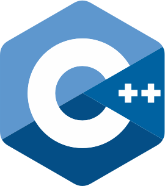

<h1 align="center">Hi 👋, I'm Ethan Mahlstedt</h1>

I'm a mexican programmer, I like math, low level systems and competitive programming.

---

<h1 align="center">Awards and recognitions:</h1>

#### 🥉| OMI 2026:
I got a bronze medal on the 31st Mexican Informatics Olympiad (OMI) in 2026, breaking my state's score record with a score of [**183.36**](https://www.olimpiadadeinformatica.org.mx/Resultados/Profile/view?usuario=_16843).

#### 6th place | TorneoMat UAG:
6th place in the XXXII UAG's nationwide math tournament. Having been invited to the award and recognition ceremony.

---

<h3 align="left">Languages and Tools:</h3>

  
 

---

- Look at my [**Codeforces Profile**](https://codeforces.com/profile/EthanMahlstedt)
- Reach me at: **ethan.mahlstedt@hotmail.com**
